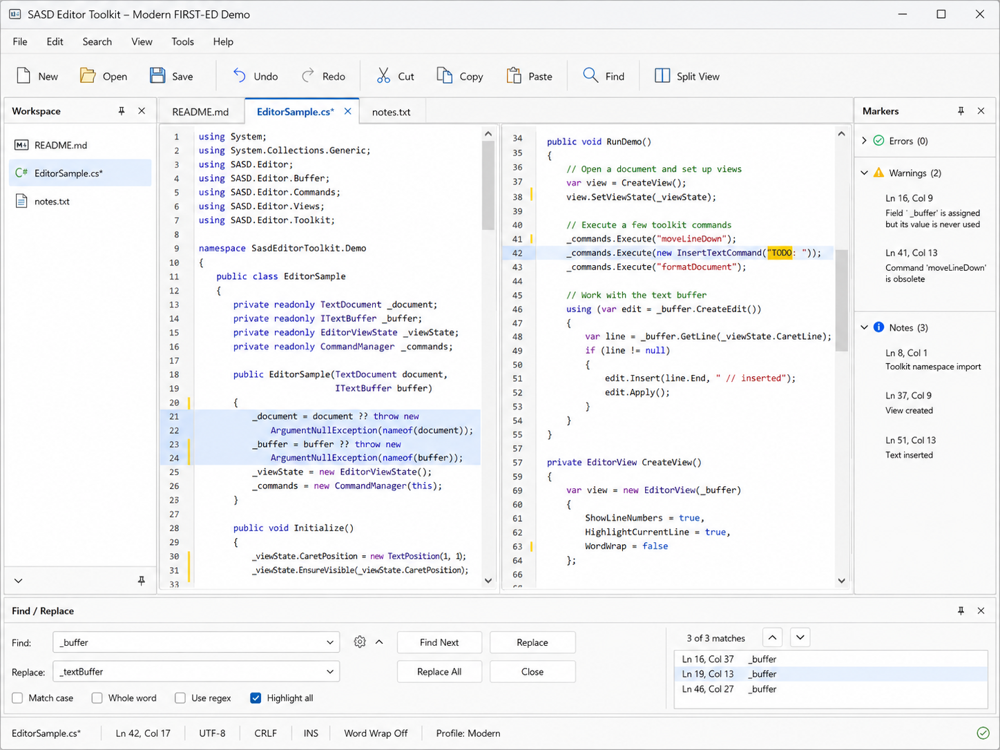

# SASD Editor Toolkit

A modern C#/.NET reference implementation of the classic editor-toolbox idea: a reusable, UI-independent text editing core with a first WinForms adapter and practical documentation for future ports.



## What this repository is

`SASD-Editor-Toolkit` is intended to become a small, understandable editor construction kit, not a full IDE and not a wrapper around one specific UI control.

The initial product line is:

```text
Host / Sample applications
        |
        v
Sasd.EditorToolkit.WinForms
        |
        v
Sasd.EditorToolkit.Core
        |
        v
BCL + host-provided services
```

The first milestone is **Modern FIRST-ED 0.1**: a minimal but real editor core, a WinForms demo, tests, and stable architectural seams.

## Documentation

- [English documentation](docs/en/README.md): [Roadmap](docs/en/ROADMAP.md), [language strategy](docs/en/Language-Strategy.md) and shared architecture/specifications.
- [Deutsche Dokumentation](docs/de/README.md): [Roadmap](docs/de/ROADMAP.md), [Lastenheft](docs/de/Lastenheft.md), [Pflichtenheft](docs/de/Pflichtenheft.md) und [Mehrsprachenstrategie](docs/de/Mehrsprachenstrategie.md).
- [Documentation overview](docs/README.md) maps shared technical and historical material.
- [Changelog](docs/en/CHANGELOG.md) / [Änderungsprotokoll](docs/de/CHANGELOG.md), [contribution guidelines](docs/en/CONTRIBUTING.md) / [Mitwirken](docs/de/CONTRIBUTING.md), [security policy](docs/en/SECURITY.md) / [Sicherheit](docs/de/SECURITY.md) and [execution-plan guidance](docs/en/PLANS.md) / [Ausführungspläne](docs/de/PLANS.md).

## Current status

The repository has moved beyond its original seed. The Core, WinForms adapter and Modern FIRST-ED sample support basic editing, undo/redo, file storage, command-driven keyboard navigation and an initial UI-independent search service. Windows GitHub Actions builds the full solution and runs the Core test suite.

The current development slice is **M1c: search and selection**. See `docs/ai/CURRENT-STATE.md` for the dated baseline and `docs/ai/NEXT-WORK.md` for the autonomous work queue.

## Codex / AI-agent development

The repository is prepared for autonomous Codex work.

- `AGENTS.md` is the short mandatory instruction map.
- `docs/ai/CODEX-AUTONOMY.md` defines autonomy, stop conditions and the development loop.
- `docs/ai/CURRENT-STATE.md` records a dated repository baseline.
- `docs/ai/NEXT-WORK.md` is the ordered queue used when the instruction is simply to continue.
- `docs/en/PLANS.md` defines execution plans for substantial changes.
- component-specific `AGENTS.md` files protect Core/WinForms/sample/test boundaries.

Typical continuation prompt: **“Continue autonomously with the first unfinished item in docs/ai/NEXT-WORK.md; follow AGENTS.md, test, document, commit and verify CI.”**

## Build

Expected local toolchain:

- .NET SDK 10.x
- Windows for the WinForms project and sample
- Git

```powershell
dotnet restore .\SASD-Editor-Toolkit.sln
dotnet build .\SASD-Editor-Toolkit.sln -c Debug
dotnet test .\SASD-Editor-Toolkit.sln -c Debug
```

On Linux you can work on docs and the Core project, but the WinForms project targets `net10.0-windows`.

## Project layout

```text
.github/workflows/               CI seed
assets/screenshots/              README and UI concept screenshots
docs/adr/                        architecture decision records
docs/de/                         German roadmap and product requirements
docs/en/                         English roadmap and reader-facing docs
docs/ai/                         Codex working-state documents
docs/notes/                      Historical engineering notes
docs/spec/                       small language-neutral practical specs
src/Sasd.EditorToolkit.Core/     UI-independent editor core
src/Sasd.EditorToolkit.WinForms/ WinForms adapter and editor surface
samples/...FirstEd.WinForms/     Modern FIRST-ED demo app
tests/...Core.Tests/             Core tests
```

## Language strategy

C#/.NET is the first and reference implementation. That does not mean that C# details define the whole product forever. Shared concepts, command IDs, settings, keyboard profiles and conformance test vectors are documented in `docs/spec/` so that later Java, C++, Web or limited PHP integration can reuse knowledge.

The basic rule is:

> Same concepts, same behavior, same command IDs, idiomatic APIs per language.

See `docs/de/Mehrsprachenstrategie.md`.

## M1 scope guard

The full Pflichtenheft is a product backlog, not a single first sprint. M1 is intentionally limited to:

- `TextDocument`
- `LineTextBuffer`
- `TextPosition` and `TextRange`
- basic insert, delete and newline operations
- dirty state
- minimal undo/redo
- file load/save
- basic command dispatcher
- a small WinForms demo
- tests and architecture rules

Everything else is planned, but later: full MicroStar-like demo, advanced blocks, markers, word-wrap/reformat, syntax highlighting, WPF, Web, Large File buffer and plugins.

## Legal note

This project is an independent SASD implementation. Do not copy Borland source code, manual scans, logos, cover art or product identity into this repository. Historical names may only be used in documentation as references.
